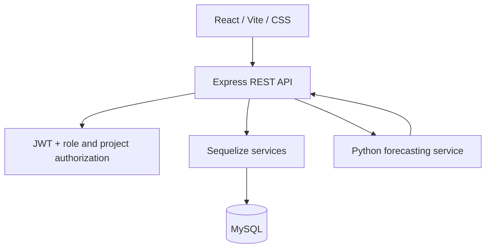

# BuildStock

**AI-powered construction material management**, built for Saurav Kumar’s project brief.

A complete source project using **React, Vite, CSS, Node.js, Express, MySQL, Sequelize, JWT, bcrypt, and a Python forecasting service**. The frontend uses React components and hooks, with the original visual design. Vite serves development on port 5173; Express serves the production build from `frontend/dist`. See `REACT_SETUP.md` for Windows commands.

Start with **[START_HERE.md](START_HERE.md)** for setup. Deployment instructions are in **[docs/DEPLOYMENT.md](docs/DEPLOYMENT.md)**.

## Included functionality

- Registration, login, logout, bcrypt password hashing, JWT authentication in HttpOnly cookies.
- Four roles: administrator, manager, storekeeper, viewer; explicit project membership.
- Project creation and editing, completion status, member assignment/removal.
- Material catalog: SKU, category, unit, current price, minimum/safety stock, editing and archiving.
- Stock in/out, live balances, stock valuation, immutable transaction history.
- Prevention of negative inventory with decimal arithmetic and database transaction locks.
- Request idempotency so retrying the same successful stock movement does not duplicate it.
- Dashboard, a 14-day movement chart, project filters, material search, paginated history.
- Project-wise inventory/consumption reports and downloadable CSV.
- Python demand forecasting, reorder suggestions, shortage alerts, unusual-consumption review flags.
- Atomic audit entries for material, project, membership, role, and stock changes.
- Responsive green/cream interface, accessible form labels, dialog forms, loading/error/empty states.
- Local Docker Compose setup, optional sample data, Render configuration, tests and API documentation.

## Architecture



The Node API reads authorized consumption history from MySQL and passes daily usage to Python. Python has no database credentials and does not decide access permissions. Neither service calls an external AI provider.

## Project structure

```text
buildstock/
  frontend/                 React JSX components, CSS, Vite, production dist
  backend/
    src/config/             Environment and database configuration
    src/models/             Sequelize models and associations
    src/routes/             REST routes and role requirements
    src/controllers/        Request parsing and responses
    src/middleware/         Authentication and project permissions
    src/services/           Atomic inventory business rules
    src/utils/              Validation and application errors
    scripts/                Initialize schema, create admin, seed demo data
    tests/                  Unit, HTTP, and optional MySQL integration tests
    server.js               Server startup and graceful shutdown
  ml-service/               Flask API and explainable forecasting model
  docs/                     API, database, deployment, test notes
  compose.yaml              Local MySQL + Node + Python services
  render.yaml               Render web and private Python services
```

## Role permissions

| Capability | Admin | Manager | Storekeeper | Viewer |
|---|---|---|---|---|
| Read inventory/reports/AI | All projects | Assigned projects | Assigned projects | Assigned projects |
| Receive/issue stock | Yes | Assigned projects | Assigned projects | No |
| Create projects | Yes | Yes | No | No |
| Edit projects | All | Assigned | No | No |
| Edit shared material catalog | Yes | Yes | No | No |
| View audit logs | All | Assigned project actions | No | No |
| Change roles and project members | Yes | No | No | No |

Registration always creates a viewer with no project assignments. Creating a project automatically assigns its creator. Administrators can access all projects without explicit membership. This is a **single-company installation**, not a multi-tenant SaaS.

## Inventory rules

Opening stock is recorded as an ordinary **IN** movement with a reason such as “Opening stock”. Current stock is the sum of IN minus OUT for a project/material pair. Quantities have up to 3 decimal places; money has 2. Movement dates are assigned by the server in UTC; the UI does not allow backdating. Corrections use an opposite movement with an explicit reference to the original record.

Every stock movement locks its project row in a database transaction, checks material availability, checks balance, then writes the ledger and audit entry together. This also serializes the first-ever movement for a project. One movement UUID must be reused for an exact network retry; reusing it for different data returns 409.

A material can be archived only when its balance is zero in every project. Its historical records remain available. A unit cannot change after stock history exists. Completed projects retain their balances and history but reject new movements. Catalog minimum stock is applied separately to each active project; project-specific thresholds can be added later.

Valuation means **current catalog price × on-hand quantity**, not accounting FIFO or weighted-average costing. Movement records retain the price at posting, used in the dashboard movement-value chart. Different units are never added into a single quantity total. Monetary displays use INR.

## How the AI works

The service trains a small, explainable statistical forecasting model from actual recorded OUT quantities:

1. Aggregate by project/material and UTC date; include zero-use days.
2. Use up to 90 completed days, excluding today’s partial consumption.
3. Require at least 14 completed days. Until then, show “Collecting history”.
4. From 14–20 days, forecast using the last 7 days’ moving average.
5. From 21 days, compare moving average and ordinary least-squares linear regression against the last 7 days using mean absolute error (MAE); choose the better method and refit on all history.
6. Clip negative trend forecasts to zero and cap extrapolation at twice the recent peak.
7. Predict 7-day demand and calculate `max(0, demand + safetyStock - currentStock)`.
8. Flag today’s usage if it exceeds the trailing average plus the larger of 3 standard deviations, 50% of the average, or 1 unit.

MAE is expressed in the material’s unit and is not a guarantee of future accuracy. A flag asks for review; it does not attribute theft, waste, or another cause. Reorder quantities do not incorporate supplier lead times, open purchase orders, or package sizes. Forecasts and alerts are computed on request; this version does not send email, SMS, or push notifications or retain dismissed-alert state. If Python is offline, inventory and low-stock alerts still work.

## Verification and practical scope

The provided implementation passed **8 Node tests and 9 Python tests** in the creation environment. JavaScript syntax checks passed. See [docs/TESTING.md](docs/TESTING.md) for the exact coverage and remaining verification.

MySQL integration, Docker builds, browser visual QA, and live Render deployment were **not run** here. A real MySQL concurrency/access test is included and must be run against a disposable database before relying on the system. The implementation is an educational MVP with real persistence and authorization, not a claim of production certification.

For larger deployments, add versioned schema migrations, SQL-side balance aggregation or balance snapshots, distributed rate limiting, password reset/session revocation, backups and restore drills, monitoring, and load tests. Current reporting reads the selected transaction history into memory. The single initial-schema command deliberately does not alter or drop existing tables.

No credentials or real project records are included. Demo data is clearly labeled and optional.
