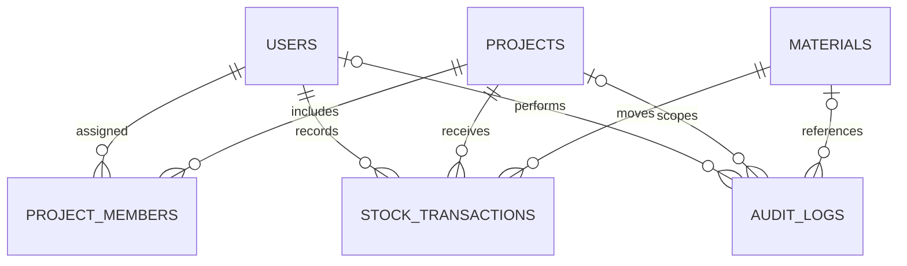

# Database design

MySQL is the persistent source of truth. Sequelize defines the tables in `backend/src/models/index.js`. The database itself must exist before running `npm run db:init`.

| Table | Key fields | Purpose |
|---|---|---|
| users | id, name, email (unique), password_hash, role, active | Identity and role |
| projects | id, name, location, status | Construction sites |
| project_members | id, project_id, user_id (unique pair) | Explicit site access |
| materials | id, name, sku (unique), category, unit, unit_price, minimum_stock, active | Shared company catalog |
| stock_transactions | id, project_id, material_id, user_id, type, quantity, unit_price, date, reason, idempotency_key (unique) | Immutable movement ledger |
| audit_logs | id, user_id, project_id, material_id, action, details (JSON), created_at | Action history |

`project_members` is an additional table required to enforce assignment-based access. User-to-project is many-to-many; a transaction belongs to one project, one material, and the user who posted it. Audit records optionally reference a project/material depending on the action.

Every project/material balance is the ledger sum of IN minus OUT. Opening inventory is an IN entry, so it is never counted twice. There is no separate mutable stock counter to drift away from history. Project row locking serializes concurrent ledger writes before balance checks, while material row locking coordinates catalog changes and archiving.

Material prices are DECIMAL(14,2); movement quantities and minimum levels are DECIMAL(14,3). Application arithmetic uses decimal.js. No floating-point arithmetic is used for stock balances or valuations. Python forecasting uses floating-point estimates, which do not mutate inventory.

No production data is deleted by startup or initialization. Deletions through the material API are soft archival. The model initialization uses `sync()` without `force` or `alter`. Use explicit versioned migrations for subsequent schema evolution.
